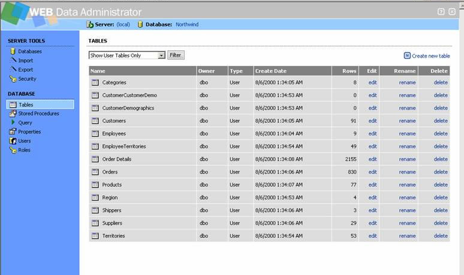

# SqlWebAdmin

[](https://github.com/gmolina75/SqlWebAdmin/actions/workflows/build.yml)

A tool to help people administer MSSQL through web pages.

There's **phpmyadmin** for MySQL, **WHY NO ONE FOR MSSQL!!??**



I picked up this project from CodePlex archives: https://archive.codeplex.com/?p=smsweb

As HaiyanDu7@gmail.com was saying on the archive page:

> **Project Description**
>
> - SQL Server Management Studio in ASP.Net
> - ASP.NET SQL SERVER ADMIN
> - SQL Server Management
> - SQL Server Studio
> - SQL Administration
> - SQL Admin
> - SQL management
> - c# SQL Server
>
> this project is trying to provide similar functions as Microsoft SQL Management
> Studio. This project is under the development. Project is not reaching beta
> version yet. But it already has many functions you can use. Please try it and
> submit the bugs when I continue on development. Anyone is welcome to join this
> project. Send me an email at HaiyanDu7@gmail.com if you would like contribute
> something. My vision to use this project is for web hosting company. Security
> Policy needs more work, especially need more testing, to make sure that there is
> no SQL user can see other's data.

Since 2007, this project became an orphan, technique has been moving forward far
from it, I decide to make it live again.

*beside I really need this functionality to assist my remote work.*

Project layout:
----------------------

- `src/SQLWebAdmin.sln` — solution with three projects.
- `src/SqlAdmin` — C# class library with the SQL Server model (databases, tables,
  users, roles, logins, SMO-style helpers) plus the value/identifier helpers used
  to build statements safely.
- `src/ContextMenu` — custom server control used for the right-click menus.
- `src/SqlWebAdmin` — the ASP.NET Web Forms site (~62 `.aspx` pages).
- `src/ExternalReferences` — third-party binaries (`AjaxControlToolkit.dll`), no NuGet.
- `tests/SqlAdmin.Tests` — unit tests for the class library.
- `.github/workflows/build.yml` — CI pipeline.

Building:
----------------------

- Open `src/SQLWebAdmin.sln` in Visual Studio 2022+ with the **.NET Framework 4.8
  Developer Pack** installed.
- Build the `SqlAdmin` and `ContextMenu` class libraries first, then run the
  `SqlWebAdmin` web site (IIS / IIS Express).
- For page-level debugging set `debug="true"` in `src/SqlWebAdmin/Web.config`; keep
  it `false` when publishing.

From the command line, the same four steps CI runs:

```bash
# 1. class libraries + tests
dotnet build tests/SqlAdmin.Tests/SqlAdmin.Tests.csproj -c Release
#    (or: msbuild src\SqlAdmin\SqlAdmin.csproj /p:Configuration=Release)

# 2. run the test executable
./tests/SqlAdmin.Tests/bin/Release/net48/SqlAdmin.Tests.exe

# 3. stage the binaries the site needs
mkdir -p src/SqlWebAdmin/Bin
cp src/SqlAdmin/bin/SqlAdmin.dll            src/SqlWebAdmin/Bin/
cp src/ContextMenu/bin/Release/ContextMenu.dll src/SqlWebAdmin/Bin/
cp src/ExternalReferences/AjaxControlToolkit.dll src/SqlWebAdmin/Bin/

# 4. precompile the whole site so broken pages fail the build
C:/Windows/Microsoft.NET/Framework64/v4.0.30319/aspnet_compiler.exe \
    -v /SqlWebAdmin -p "$PWD/src/SqlWebAdmin" /tmp/precompiled
```

Tests:
----------------------

- Tests live in `tests/SqlAdmin.Tests` and have **no NuGet dependencies**
  (SDK-style project targeting `net48`).
- Build and run them with:

  ```bash
  dotnet build tests/SqlAdmin.Tests/SqlAdmin.Tests.csproj -c Release
  ./tests/SqlAdmin.Tests/bin/Release/net48/SqlAdmin.Tests.exe
  ```

- The runner prints a summary and exits with code `0` only when every test passes.
- Current coverage (47 tests):
  - **connection strings** — SQL auth, integrated security, omitted server name;
  - **`SplitSqlBatches`** — case-insensitive `GO`, mixed newlines, empty batches;
  - **`ValidateDatabaseName`** — connection-string injection guard;
  - **`SqlIdentifier`** — bracket quoting, `]` escaping, qualified names, name validation;
  - **`SqlLiteral`** — quote escaping, unicode, and **culture-invariant** number/date
    formatting (a script generated under `es-ES` must not contain `3,14`);
  - **`Security.WebServer`** — null-safe outside a web context.

Continuous integration:
----------------------

- `.github/workflows/build.yml` runs on every push and pull request on
  `windows-latest`:
  1. builds `SqlAdmin`, `ContextMenu` and the tests with MSBuild,
  2. runs the test executable and fails the job if any test fails,
  3. copies the freshly built DLLs into `src/SqlWebAdmin/Bin`,
  4. precompiles the whole site with `aspnet_compiler` so broken pages fail the
     build.

Security notes:
----------------------

- No connection strings live in `Web.config`; every user signs in with their own
  SQL Server credentials, and a guard rejects database names that try to smuggle
  statements into the connection string.
- The login ticket stores only the login type (never a password) and travels in an
  `HttpOnly` cookie with `SameSite=Lax`; signing out calls
  `FormsAuthentication.SignOut()` instead of just navigating away.
- Error pages HTML-encode exception details and query strings (including the error
  code, now parsed defensively), so crafted input cannot inject markup.
- Security headers are added on every response: `X-Frame-Options`,
  `X-Content-Type-Options`, `X-XSS-Protection` and `Referrer-Policy`.
- Session expiry redirects to `Login.aspx?error=sessionexpired` instead of a page
  that never existed.
- **Statements are built in one of two safe ways only:**
  - identifiers (table, column, owner) go through
    **`SqlIdentifier.Quote` / `QuoteQualified`**, which brackets them and doubles
    embedded `]` — a table named `x]; drop ...` stays data;
  - values go through **parameters** (`SqlServer.ExecuteNonQuery`) or, when
    generating a script, **`SqlLiteral.Format`**, which escapes quotes and formats
    numbers/dates culture-invariantly.
  - Anything else (free-form SQL typed by the user on the Query page) is executed
    as the user's own session — that page is the point of the tool.

Interface:
----------------------

- `src/SqlWebAdmin/admin.css` is the single stylesheet for all pages. It is
  organised around CSS custom properties in a `:root` block at the top:
  surfaces, ink levels (four), lines, one accent, semantic colours, control
  tokens, a radius scale and a 4px spacing scale.
- **Existing class names are preserved.** The ~62 legacy pages keep working
  unchanged; new classes (`.banner`, `.emptyState`, `.loginCard`, …) are additive.
- The visual signature — the dotted rule that opens each section, the tool rail
  with its selected state, and the silver/blue structural bands — is kept; the
  band colours `#c0c0c0` and `#99ccff` match the shipped logo artwork and should
  not be changed without checking `images/logo_top.gif`.
- Keyboard focus (`:focus-visible`) is defined for every interactive element, and
  motion is disabled under `prefers-reduced-motion`.

Known limitations:
----------------------

- The row grid on `viewTableData.aspx` loads at most **200 rows**; the page says so
  and points at the Query page for the full result. There is no pager yet.
- Roles and users still go through the legacy **DMO interop**, not the modern APIs.
- The tool is Web Forms and is not responsive below ~560px; it is meant for a
  desktop browser.
- Sign-in has been verified end to end only up to the point where SQL Server
  credentials are required.

TODO:
----------------------

- [x] Make it work with **SQL standard authentication** (done)
- [x] Automated build + tests + CI (done)
- [x] Safe identifier/value helpers with tests (`SqlIdentifier`, `SqlLiteral`) (done)
- [x] Design-token stylesheet, focus states, empty states, login UX (done)
- [ ] Replace the remaining concatenated SQL in the older pages with
      `SqlIdentifier`/`SqlLiteral` or parameters (the row editor is done)
- [ ] Add paging to `viewTableData.aspx` instead of a fixed 200-row cap
- [ ] Reimplement database roles / users on modern APIs instead of the legacy DMO
      interop
- [ ] Move to ASP.NET **MVC** instead of WebForm

Contributing:
----------------------

See [CONTRIBUTING.md](CONTRIBUTING.md). Changes are tracked in
[CHANGELOG.md](CHANGELOG.md).
